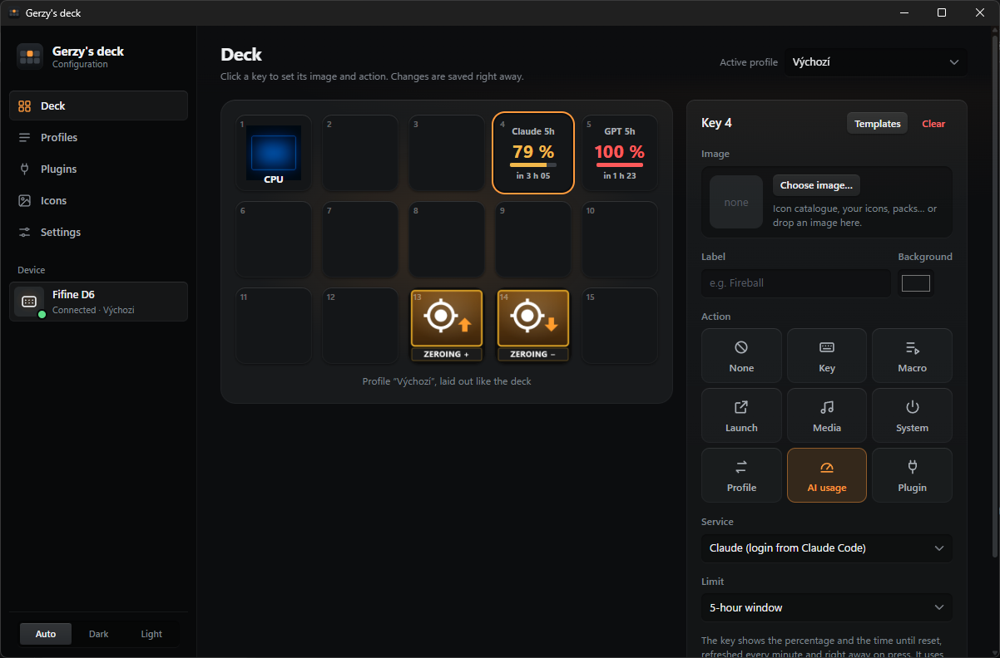
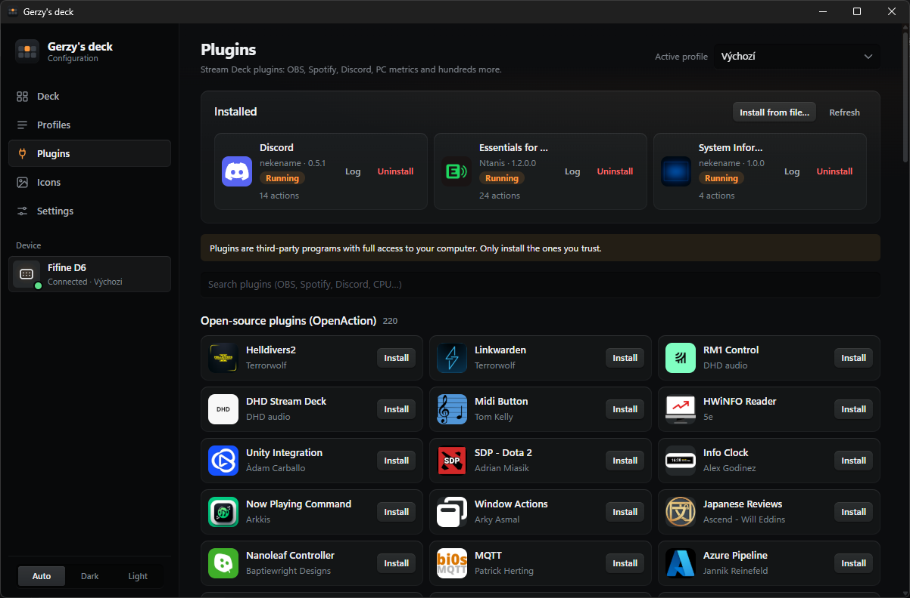
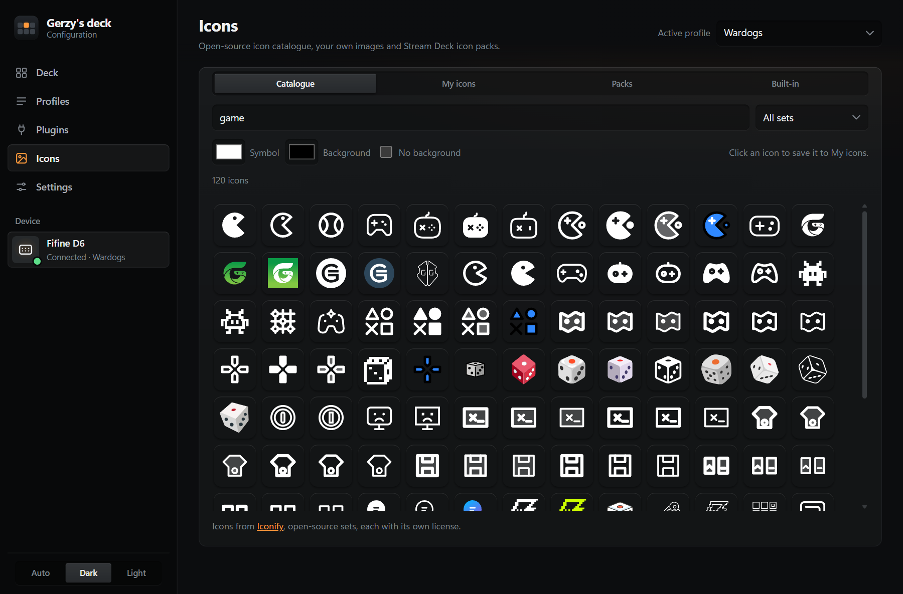
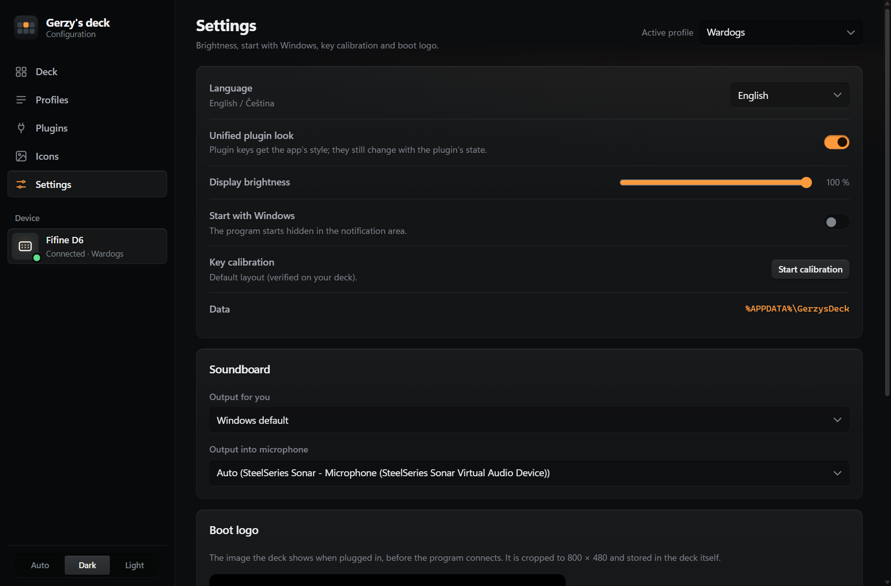
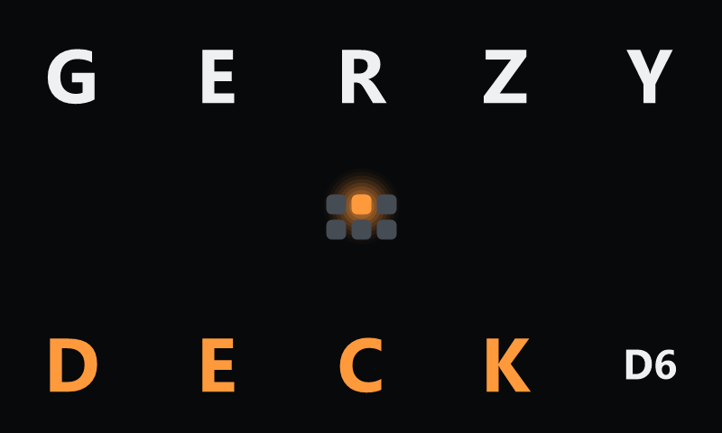

# gerzyDECK

Unofficial Windows software for the **Fifine AmpliGame D6** (15 LCD keys), a replacement for the vendor app. Built with Rust and Tauri.



## Features

- **Keys:** your own images (icon catalogue, your icons, icon packs), labels and background colour; drag a key onto another to swap them.
- **Actions:** key or shortcut, macro, launch a program or website, media and volume, lock or sleep the PC, switch profile.
- **Profiles:** 15 keys each, switching automatically by the program in the foreground (e.g. `wow.exe`).
- **Stream Deck plugins:** install straight from the app, from the OpenAction catalogue and the Elgato store archive (OBS, Spotify, Discord, PC metrics and hundreds more).
- **AI usage:** keys showing your Claude and ChatGPT (Codex) plan limits and the time until they reset.
- **Icons:** the Iconify catalogue (over 200,000 open-source icons), your own icon library and `.streamDeckIconPack` import.
- **Boot logo:** your own 800 × 480 image shown when the deck is plugged in.
- **Languages:** English and Czech.

The program lives in the notification area (tray). Click the icon to open the editor; closing the window keeps it running.

| Plugins | Icons |
| --- | --- |
|  |  |

| Settings | Boot logo |
| --- | --- |
|  |  |

## Installation

1. Quit **fifine Control Deck** (including its tray icon) and disable its autostart, otherwise both apps fight over the deck.
2. Run `Gerzys Deck_<version>_x64-setup.exe` and accept the license terms.
3. In the editor, open **Settings** and turn on "Start with Windows".

Settings, images, icons and plugins are stored in `%APPDATA%\GerzysDeck`.

## Important

This is unofficial software and you use it **at your own risk**. The full terms are in [`src-tauri/LICENSE.txt`](src-tauri/LICENSE.txt) and are shown by the installer. In short:

- **Boot logo** is written to the deck's persistent memory. The format was captured from the official app and verified, but an interrupted write (unplugging the deck, or another program writing to it at the same time) could damage the device in the worst case.
- **AI usage** reads undocumented Anthropic and OpenAI interfaces with the logins of Claude Code and Codex, and refreshes them when they expire. These interfaces may change or stop working at any time.
- **Plugins** are third-party programs running on your computer. Only install ones you trust.
- **Keys and macros:** some games (anti-cheat) forbid simulated input. In World of Warcraft, more than one game action per key press breaks Blizzard's rules.

## Development

You need Rust (rustup, MSVC toolchain), the Microsoft C++ Build Tools and Node.js (for the Tauri CLI).

```powershell
npm install
npm run dev        # run the app in development mode
npm run build      # build the installer (src-tauri/target/release/bundle/nsis/)
cd src-tauri
cargo test --lib   # tests
```

### Device diagnostics

Run these only while neither gerzyDECK nor the Fifine app is running.

```powershell
cd src-tauri
cargo run --bin diag                # numbers 1–15 on the keys + key press log
cargo run --bin diag -- --frame104  # measuring frames (a key's display is 104×104 px)
cargo run --bin diag -- --type      # keyboard output test (click into Notepad)
cargo run --bin boot_logo_replay -- image.png   # upload a boot logo
```

## Notes

- Keys are sent as scan codes (by position on the keyboard), so games see them as a real keyboard.
- Windows does not let keys into windows running as administrator; the editor warns about it.
- A key's display is 104×104 px; the boot logo is 800×480, laid out as a 5×3 grid of 160 px cells (one cell per key).

## License

The source code is released under the [MIT License](LICENSE). The installer additionally shows the terms of use and disclaimer in [`src-tauri/LICENSE.txt`](src-tauri/LICENSE.txt).

## Credits

- Device protocol based on [fifine-ampligame-d6](https://github.com/micah1crandell/fifine-ampligame-d6) (MIT); the boot logo command was captured from the official app.
- Stream Deck SDK compatible plugin host; plugins from the [OpenAction](https://openaction.amankhanna.me) catalogue and the Elgato store archive.
- Icons from [Iconify](https://iconify.design); every icon set has its own license.
- Built with [Tauri](https://tauri.app).

gerzyDECK is not affiliated with Fifine, Mirabox, Elgato/Corsair, Anthropic or OpenAI. All trademarks belong to their owners.
